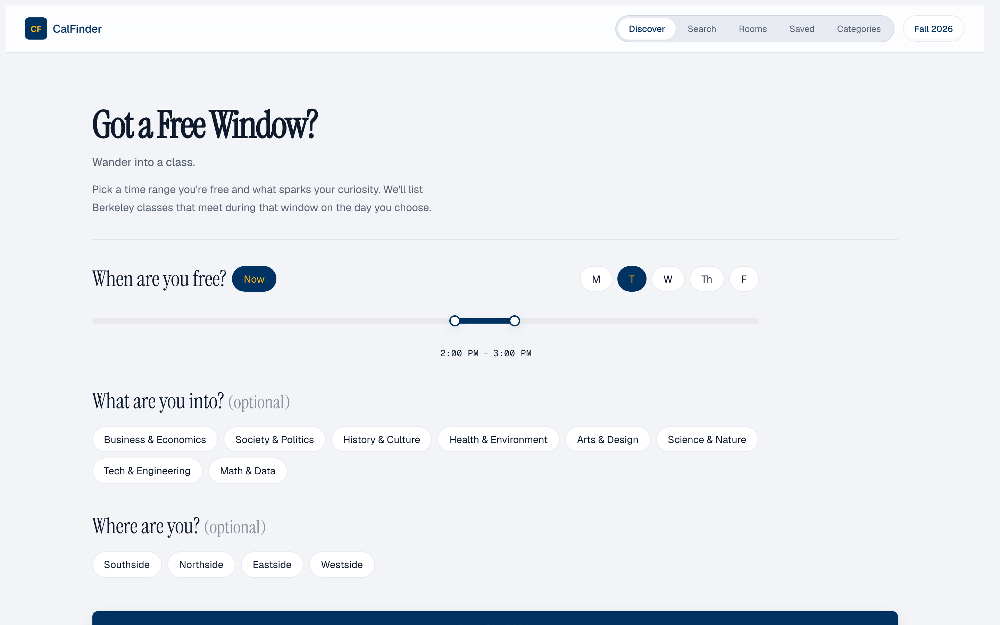
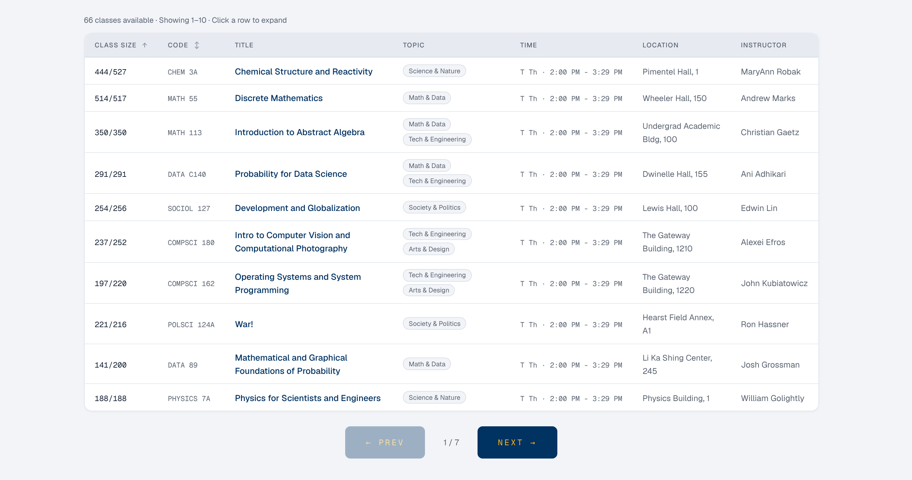

# CalFinder

**Find a UC Berkeley lecture to sit in on, right now, near you.**

**Live: [calfinder.app](https://calfinder.app)**





## What it does

CalFinder turns the Berkeley class schedule into something you can browse in your free time:

- **Discover**: pick a time window and see lectures happening then, filtered by interest and walking distance
- **Search & categories**: browse ~2,000 Fall 2026 sections by subject, department or interest
- **Rooms**: any classroom's weekly schedule as a calendar grid, with seat counts for 160+ rooms
- **Saved**: save classes, see them as a week, and export them all to your calendar
- Shareable links for classes and rooms; mobile-first UI

## Tech stack

- **Next.js 16** (App Router, static API route) + **React 19**, **TypeScript**
- Hand-written CSS (styled-jsx + CSS modules)
- Data pipeline: Node scraper validated against a **JSON Schema** (Ajv) → `catalog.json` + `offerings.json`, joined server-side
- Deployed on **Vercel** (Web Analytics, Speed Insights)

## My role

Solo project: idea, data pipeline, design and development.

## Running it locally

```bash
npm install
npm run dev     # http://localhost:3000
```

Course data lives in `data/` (see `data/README.md`). Class times and rooms come from UC Berkeley's public class schedule and classroom database; always confirm on [classes.berkeley.edu](https://classes.berkeley.edu). Not affiliated with UC Berkeley.
